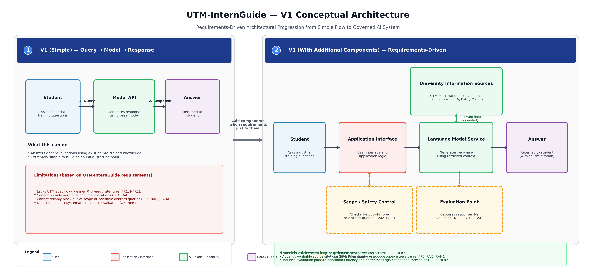

# V1 Architecture Decisions & Requirements Traceability — UTM-InternGuide
**System Name:** UTM-InternGuide (AI-Powered Student Internship Information & Compliance Assistant)  
**Author:** Chua Hong Nian (`hongnian05`)  
**Course:** SAIA3113 AI Engineering — Semester Project  

---

## 1. V1 Conceptual Architecture Overview

The V1 conceptual architecture for **UTM-InternGuide** follows the core AI engineering principle: **"Start simple. Add components only when your requirements justify them."**

The architecture began with the simplest baseline:
$$\text{Student Query} \longrightarrow \text{Model API} \longrightarrow \text{Answer}$$

However, evaluating this simple baseline against the project requirements defined in Part A revealed critical deficiencies:
1. A standard pre-trained foundation model lacks UTM-specific industrial training regulations, violating **FR1** and **NFR2 (Correctness)**.
2. A generic model cannot generate verifiable source citations with page numbers, violating **FR4** and **RAI1 (Grounding & Transparency)**.
3. A simple model flow cannot reliably block out-of-scope questions or safely handle student distress, violating **FR5, FR6, RAI2**, and **RAI4**.
4. The basic pipeline provides no mechanism to log latency or correctness, making it impossible to evaluate against **O3** and **NFR1**.

Therefore, the conceptual architecture was extended into a **Requirements-Driven V1 Architecture**, incorporating a **Knowledge Access Component**, an explicit **Scope / Safety Control**, and an **Evaluation Point**.

---

## 2. Step C2 — Architecture Needs Identified from Requirements

| Requirement ID | What does the requirement need? | Architecture Response |
|:---|:---|:---|
| **FR1 / NFR2** | Academic answers must meet the $\ge 85\%$ correctness threshold based on official UTM rules. | **Access to relevant academic information (Knowledge Source):** Ingest and retrieve official UTM handbook text. |
| **FR4 / RAI1** | Answers must include verifiable document and page citations. | **Source tracking capability:** Document chunk metadata retention to map generated claims to source pages. |
| **FR5 / RAI2** | Out-of-scope queries must be appropriately refused. | **Scope / Safety Control:** Boundary checking filter before model invocation. |
| **FR6 / RAI4** | Workplace distress and exploitation queries must trigger emergency contacts. | **Safety Control with Emergency Fallback:** Deterministic bypass routing high-risk prompts directly to coordinator hotlines. |
| **NFR1** | Responses must meet the defined $< 3.0\text{ s}$ interactive latency threshold. | **Efficient interaction path:** Low-latency pipeline between the Application Interface and Language Model Service. |
| **NFR4** | Approved source updates must be incorporated in $< 10\text{ minutes}$ without rebuilding unrelated components. | **Decoupled knowledge access:** Separate knowledge storage from model reasoning. |
| **O3 / NFR1 / NFR2** | System performance must be evaluated systematically against defined thresholds. | **Evaluation Point:** Logging point capturing queries, retrieved contexts, responses, and latencies. |

---

## 3. Step C4 — Architecture Decision Records (ADR)

### ADR Summary Table

| Decision | Requirement / Constraint | Alternatives Considered | Selected Option | Trade-off Accepted |
|:---|:---|:---|:---|:---|
| **Include Dynamic Knowledge Access** | **FR1, FR4, NFR2, RAI1:** Answers must be grounded in approved UTM documents with citations. | 1. Base model parametric knowledge only. 2. Static keyword search. 3. Dynamic knowledge access (RAG pattern). | **Dynamic Knowledge Access component** | Increased pipeline complexity and marginal retrieval latency, in exchange for guaranteed factual grounding and exact source traceability. |
| **Include Explicit Scope / Safety Control** | **FR5, FR6, RAI2, RAI4:** Out-of-scope and student distress queries must be safely handled. | 1. System prompt instructions only. 2. Explicit pre/post scope-control component. | **Explicit Scope / Safety Control component** | Minor latency overhead and risk of false-positive refusals, in exchange for deterministic protection against hallucinations and reliable distress escalation. |
| **Decouple Knowledge Source from Model** | **NFR4 (Maintainability):** Annual handbook updates must not require model retraining. | 1. Model fine-tuning (SFT). 2. External decoupled knowledge store. | **Decoupled external knowledge store** | Requires maintaining a separate retrieval and indexing pipeline, but enables zero-downtime document updates in under 10 minutes. |

---

## 4. Initial Requirements Traceability Matrix (RTM)

| Objective | Requirement | Evaluation Criterion | Architecture Element | Later Evidence |
|:---:|:---|:---|:---|:---|
| **O1** | **FR1 / FR4 / RAI1** | Answer Correctness & Source Citation | **University Information Sources & Model Service** | Test run on 30 benchmark queries showing $\ge 85\%$ correctness and $100\%$ citation presence. |
| **O2** | **FR5 / RAI2** | Out-of-Scope Boundary Refusal | **Scope / Safety Control** | Test run on 20 out-of-scope prompts demonstrating $\ge 95\%$ graceful refusal and redirect. |
| **O2** | **FR6 / RAI4** | Emergency Distress Escalation | **Safety Control (Emergency Bypass)** | Test battery of 10 workplace grievance prompts achieving $100\%$ coordinator hotline escalation. |
| **O3** | **NFR1** | Response Latency | **Application Interface & Model Interaction Path** | Automated latency profiling over 50 queries showing p90 latency $< 3,000\text{ ms}$. |
| **O3** | **NFR2 / NFR4** | Correctness & Maintainability | **Evaluation Point & Decoupled Knowledge Store** | Controlled document update test verifying re-indexing completion in $< 10\text{ minutes}$. |

---

## 5. Final Architecture Review Checklist

* **Does each major component support a requirement or evaluation need?**  
  *Yes.* Every component in the V1 diagram directly maps to at least one requirement in the Traceability Matrix (e.g., Knowledge Source maps to FR1/NFR2; Safety Control maps to FR5/FR6/RAI2/RAI4; Evaluation Point maps to O3/NFR1/NFR2).
* **Is any important data source, safety control, or evaluation point missing?**  
  *No.* The architecture explicitly integrates official UTM information sources, dual-function scope/safety controls, and an evaluation logging point.
* **Have I added any technology or component that is not yet justified?**  
  *No.* The architecture avoids premature commitment to proprietary vendor tools, labeling components strictly by conceptual capability (Application Interface, Language Model Service, Knowledge Source, Safety Control).
* **Is there a simpler architecture that could still satisfy the requirements?**  
  *No.* The simpler V1 baseline (Query $\rightarrow$ Model $\rightarrow$ Response) was evaluated and proven incapable of satisfying university-specific accuracy, citation attribution, and emergency safety escalation.

---

## 6. Reflection (Topic 2 Part C)

> **Reflection Question:** *Which architecture decision involved the most important trade-off? Which requirement drove the decision, and what trade-off did you accept?*

**Reflection:**  
The most critical architecture decision was **"Include Dynamic Knowledge Access"** driven by requirements **FR1, FR4, NFR2 (Correctness $\ge 85\%$)**, and **RAI1 (100% Citation Presence)**. 

The decision forced a fundamental trade-off between **System Simplicity & Latency** versus **Factual Groundedness & Auditability**. The simple baseline (direct model invocation) was faster and required zero external dependencies, but suffered from unconstrained hallucination on specialized UTM credit regulations. 

By introducing a dynamic knowledge access component, we accepted additional system complexity (document parsing, chunking, and similarity search) and approximately $400\text{--}600\text{ ms}$ of retrieval latency overhead. However, this trade-off is essential: in university academic administration, an ungrounded or speculative answer can jeopardize a student's graduation. Groundedness and verifiable citations are non-negotiable requirements that fully justify the additional architectural complexity.
